  

  
  
  
  
  
  

---

# 🤖 Awesome Virtual Agent: Enterprise & Open-Source Conversational AI Ecosystem

> ⚡ **A curated directory of leading SaaS platforms and self-hosted open-source repositories for building, deploying, and orchestrating intelligent virtual agents, AI copilots, customer support bots, and agentic workflows.**

Welcome to the definitive resource on **Intelligent Virtual Agents (IVAs)**, **Conversational AI**, and **Autonomous Agentic Assistants**. Whether you are an enterprise IT architect automating ITSM service desks, a customer support director implementing omnichannel CX bots, or an open-source engineer building sovereign, self-hosted LLM assistants, this index tracks the state of the art across both commercial SaaS vendors and community-driven GitHub projects.

---

## 📑 Table of Contents

- [📊 Sector Overview & Market Dynamics](#-sector-overview--market-dynamics)
- [🏢 Enterprise SaaS & Hosted Virtual Agent Platforms](#-enterprise-saas--hosted-virtual-agent-platforms)
- [🔓 Open-Source GitHub Virtual Agent Frameworks](#-open-source-github-virtual-agent-frameworks)
- [⚖️ Architectural Decision Matrix: SaaS vs. Open-Source](#️-architectural-decision-matrix-saas-vs-open-source)
- [🎯 Key Evaluation Criteria for Virtual Agents](#-key-evaluation-criteria-for-virtual-agents)
- [❓ Frequently Asked Questions (FAQ)](#-frequently-asked-questions-faq)
- [🤝 How to Contribute](#-how-to-contribute)
- [🛡️ Compliance & Disclaimer](#️-compliance--disclaimer)
- [⭐ Star History](#-star-history)
- [💖 Support & Sponsorship](#-support--sponsorship)

---

## 📊 Sector Overview & Market Dynamics

The global **Intelligent Virtual Agent (IVA)** and **Conversational AI** market size was valued at approximately **$11.5 billion in 2024** and is projected to surge to over **$45.2 billion by 2030**, reflecting an accelerating compound annual growth rate (**CAGR of ~25.6%**). This expansion is fueled by the transition from static decision-tree chatbots to generative, multi-modal, agentic assistants capable of reasoning, executing dynamic API actions, and managing long-horizon workflows.

In terms of structure, the sector is **moderately to highly fragmented** rather than a winner-take-all monopoly:
- **Cloud & Enterprise Titans** (*Microsoft, IBM, ServiceNow*) capture internal enterprise service desks, ITSM automation, and office productivity copilots where enterprise IT governance and Active Directory integration dominate.
- **Pure-Play Omnichannel Specialists** (*Ada, Cognigy, Kore.ai, Yellow.ai, Amelia*) dominate mission-critical contact centers, high-volume consumer customer experience (CX), and voice telephony automation requiring bespoke NLU, sentiment intelligence, and CRM handoff.
- **The Sovereign Open-Source Movement** (*Dify, Open WebUI, LibreChat, AutoGen, CrewAI, Flowise, Rasa, Chatwoot*) commands massive developer adoption, allowing organizations in healthcare, defense, and finance to avoid per-conversation vendor lock-in while ensuring strict on-premise data sovereignty and compliance.

---

## 🏢 Enterprise SaaS & Hosted Virtual Agent Platforms

The table below lists industry-leading commercial SaaS virtual agent suites, **sorted in descending order by company size** (market capitalization or latest enterprise valuation).

| 🏢 Platform / Vendor | 📈 Company Size (Valuation / Revenue) | 💵 Starting Tier Pricing | 🎁 Free Tier & Trial Limits | 🎯 Key Capabilities & Use Cases |
| :--- | :--- | :--- | :--- | :--- |
| **[Microsoft Copilot Studio](https://www.microsoft.com/en-us/microsoft-copilot/microsoft-copilot-studio)** | **~$3.1 Trillion Market Cap** ($245B+ Annual Revenue) | **$200 / tenant / month** (Capacity pack includes 25,000 Copilot Credits; or $0.01/credit pay-as-you-go via Azure) | **30-Day Free Trial** (extendable to 90 days; covers full agent designer, generative answers & in-studio test panel; external channel publishing blocked until paid) | Low-code enterprise agent authoring studio with dynamic multi-plugin actions, generative answers, voice/IVR telephony, and deep native Microsoft 365 Copilot & Power Platform governance. |
| **[IBM watsonx Assistant](https://www.ibm.com/products/watsonx-assistant)** | **~$215 Billion Market Cap** ($62B+ Annual Revenue) | **$140 / month** (Plus Plan; covers first 1,000 MAUs, then $14 per additional 100 MAUs) | **Free Forever Lite Plan** (capped at 1,000 Monthly Active Users (MAUs), up to 3 virtual assistants, and 7-day conversation history; phone integration excluded) | Enterprise virtual agent with conversational search, skills-based actions, multi-llm RAG orchestration, and telephony connectors (Genesys, Twilio, NICE). |
| **[ServiceNow Virtual Agent](https://www.servicenow.com/)** | **~$185 Billion Market Cap** ($10.5B+ Annual Revenue) | **~$70 – $100 / fulfiller agent / month** (Bundled within ITSM Pro / CSM Pro tiers; enterprise annual agreements typically start at ~$10,000/year; Virtual Agent Lite included in ITSM Standard) | **Free Personal Developer Instance (PDI)** (via ServiceNow Developer Program; full sandboxed Virtual Agent Designer with NLU; auto-hibernates after 10 days of inactivity; no live commercial routing) | IT Service Management (ITSM), HR service delivery, multi-step incident resolution, conversational workflows across Slack/Microsoft Teams, and agentic AI action execution. |
| **[Salesloft Chat Agents (Drift)](https://www.drift.com/)** | **~$2.3 Billion Valuation** (Vista Equity acquisition; ~$200M ARR) | **$2,500 / month** (Premium Plan billed annually at $30,000/year; includes live chat, automated lead routing, and conversational AI scheduling) | **14-Day Guided Pilot Trial** (arranged via Salesloft engineering; includes test sandbox, demo CRM connector, and simulated inbound lead traffic; no self-serve free plan) | B2B conversational marketing, automated website pipeline acceleration, real-time qualification, and calendar meeting booking for enterprise revenue teams. |
| **[Amelia](https://amelia.ai/)** | **~$1.9 Billion Market Cap** (SoundHound AI NASDAQ: SOUN; ~$85M ARR) | **~$3,500 / month** (Standard enterprise deployment tier; billed annually from ~$42,000/year including base digital employee license) | **30-Day Guided Enterprise PoC** (structured proof-of-concept sandbox arranged via SoundHound solutions team with domain knowledge ingestion; no public freemium) | Cognitive digital workforce platform with deterministic process execution, emotional sentiment recognition, custom on-premise LLMs, and multi-step IT/customer service automation. |
| **[Ada](https://www.ada.cx/)** | **~$1.2 Billion Valuation** (Series C unicorn; $130M+ venture funding) | **~$2,500 / month** (Billed annually at $30,000/year minimum entry platform tier; includes core AI Agent & automated resolution metering) | **14-Day Guided PoC Sandbox** (provided via sales demonstration; includes automated knowledge base crawler and test web chat widget; no self-serve free plan) | Autonomous customer service resolution across chat, email, SMS, and voice; API-driven Actions with seamless human handoff to Zendesk, Salesforce, and Genesys. |
| **[Cognigy](https://www.cognigy.com/)** | **~$950 Million Valuation** ($100M Series C led by Eurazeo; $175M total funding) | **~$2,500 / month** (Starter enterprise deployment package billed annually around $30,000–$43,000/year for core conversational platform) | **14-Day Enterprise Trial Environment** (capped at 1.5 MB HTTP payload limit and structured test interaction quotas via sales scoping; no public free tier) | Hybrid AI platform combining deterministic NLU with Agentic LLM reasoning, visual flow studio, Knowledge AI RAG, native voice telephony gateway, and multimodal xApps. |
| **[Kore.ai](https://kore.ai/)** | **~$500 Million Valuation** ($150M total funding; ~$60M ARR) | **$100 Minimum Deposit** (Pay-as-you-go billed at ~$0.20 per 15-minute conversation session; enterprise annual contracts start at ~$50,000/year) | **Free Forever Dev Sandbox + $500 Trial Credit** (free unlimited bot building/testing in sandbox; new accounts receive $500 free credit valid for 90 days for live testing) | Enterprise XO Platform for omnichannel virtual assistants, AgentAssist real-time agent coaching, contact center AI integration, and multi-model LLM orchestration. |
| **[Yellow.ai](https://yellow.ai/)** | **~$350 Million Valuation** ($102M venture funding; ~$40M ARR) | **~$599 / month** (Growth Plan starting tier; overage resolutions billed at $0.99/session; enterprise plans start at ~$1,500/month) | **Free Forever Tier** (includes 1 AI Agent, 2 human agent seats, and up to 500 chat sessions/month; overages billed at $0.99 per resolution session) | Multi-LLM agentic architecture (GPT-4o, Claude, DeepSeek), Agentic RAG, dynamic voice AI in 135+ languages, and 100+ turnkey enterprise connectors (Salesforce, SAP, ServiceNow). |
| **[LivePerson](https://www.liveperson.com/)** | **~$120 Million Market Cap** (NASDAQ: LPSN; ~$380M Annual Revenue) | **$599 / month** (Starter Plan billed annually; supports up to 10 user seats and ~2,000 monthly automated messaging conversations) | **45-Day Free Sandbox Trial** (Conversational Cloud trial for bot creation and web messaging testing; limited to 1 bot builder; production channel rollout requires paid upgrade) | Enterprise asynchronous messaging and voice orchestration, LivePerson Sync for CCaaS/CRM integration, event-driven intent routing, and AI agent workspaces. |

---

## 🔓 Open-Source GitHub Virtual Agent Frameworks

Below is the curated collection of self-hosted, sovereign, and developer-centric open-source virtual agent frameworks, **sorted in descending order by GitHub stargazer count**. Each repository badge links directly to its live GitHub stargazers page.

- **[Dify](https://github.com/langgenius/dify)**   
  *All-in-one open-source LLM application development platform and agent orchestrator.* Combines visual conversational flow design, RAG pipelines, multi-model support, tool execution, and out-of-the-box embeddable web chat widgets for production-grade AI virtual assistants.

- **[Open WebUI](https://github.com/open-webui/open-webui)**   
  *User-friendly, highly extensible self-hosted AI interface and assistant platform.* Provides complete Ollama and OpenAI API compatibility, built-in RAG document interrogation, agent pipelines, web search integration, voice call mode, and fine-grained role-based access control (RBAC).

- **[Lobe Chat](https://github.com/lobehub/lobe-chat)**   
  *Modern open-source conversational AI framework and virtual agent workstation.* Features multi-modal support (vision, speech-to-text, text-to-speech), dynamic plugin marketplace, multi-agent management, artifact generation, and support for all major commercial and local LLM providers.

- **[AutoGen](https://github.com/microsoft/autogen)**   
  *Microsoft's pioneering framework for agentic AI and multi-agent conversations.* Enables building next-generation virtual agent systems where specialized autonomous agents converse, reason cooperatively, execute code, and integrate human feedback to solve complex enterprise workflows.

- **[CrewAI](https://github.com/crewAIInc/crewAI)**   
  *Lean multi-agent orchestration framework for collaborative virtual agents.* Allows developers to define autonomous agents with distinct personas, tools, memory, and objectives, coordinating structured sequential and hierarchical delegations for business processes.

- **[Flowise](https://github.com/flowiseai/Flowise)**   
  *Visual drag-and-drop canvas for building customized conversational agents and RAG pipelines.* Powered by LangChain and LlamaIndex, Flowise enables zero-code and low-code assembly of multi-agent assistants, memory stores, and API integrations with instant webhook endpoints.

- **[LibreChat](https://github.com/danny-avila/LibreChat)**   
  *Enterprise-ready open-source AI conversational platform.* Delivers support for custom AI Agents, Model Context Protocol (MCP), multi-model selection (Claude, GPT, Gemini, Mistral, Ollama), file search, code execution, multi-user moderation, and secure Docker/Kubernetes deployment.

- **[Chatwoot](https://github.com/chatwoot/chatwoot)**   
  *Open-source omnichannel customer support platform (MIT License).* Serves as the ultimate human-in-the-loop and handoff gateway for virtual agents; integrates live web chat, WhatsApp, Twitter, and email with webhook-driven bot connectivity and agent assignment logic.

- **[Rasa](https://github.com/RasaHQ/rasa)**   
  *Industry-standard conversational AI framework (Python) for mission-critical enterprise assistants.* Combines CALM (Conversational AI with Language Models) for generative dialogue with deterministic business logic flows, automated conversation repair, and enterprise data privacy boundaries.

- **[Botpress](https://github.com/botpress/botpress)**   
  *Developer-centric chatbot platform and agent hub.* Features visual flow editing, native intent classification, slot tagging, autonomous reasoning nodes, multi-channel connectors (Slack, Teams, Telegram, WhatsApp), and hybrid cloud/on-prem deployment options.

- **[Typebot](https://github.com/baptisteArno/typebot.io)**   
  *Visual conversational form and lead-generation chatbot builder.* Offers 30+ interactive block types, native OpenAI/Anthropic blocks, conditional logic branching, and customizable embeddable web chat widgets with zero per-conversation pricing limits.

- **[Vocode Core](https://github.com/vocodedev/vocode-core)**   
  *Open-source Python library for building real-time voice-based virtual agents.* Handles low-latency audio streaming, telephony bridging (Twilio/Vonage), turn-taking management, speech-to-text (Deepgram/Whisper), and voice synthesis (ElevenLabs/PlayHT).

- **[Tock](https://github.com/theopenconversationkit/tock)**   
  *Open-source conversational AI toolkit built with Kotlin.* Maintained by The Open Conversation Kit, offering end-to-end bot lifecycle management, multi-lingual NLU, complex story graphs, Docker Compose deployment, and React/Vue front-end embedding toolkits.

---

## ⚖️ Architectural Decision Matrix: SaaS vs. Open-Source

| Evaluation Vector | 🏢 Commercial Enterprise SaaS | 🔓 Self-Hosted Open Source |
| :--- | :--- | :--- |
| **Deployment Time** | ⚡ Hours to days (turnkey web consoles, pre-built integrations) | ⏳ Days to weeks (infrastructure setup, container orchestration) |
| **Data Privacy & Sovereignty** | ☁️ Multi-tenant or single-tenant cloud (subject to vendor data agreements) | 🛡️ 100% on-premise / private VPC control; zero data leakage |
| **Customizability** | 🎛️ Limited to vendor extension points, webhooks, and SDKs | 🧩 Complete code-level control, custom models, custom UI, and MCP servers |
| **Cost Scaling Model** | 💳 Predictable entry fees with escalating per-conversation / MAU surcharges | 💻 Fixed compute/infrastructure costs regardless of conversation volume |
| **Maintenance Burden** | 🛠️ Zero infrastructure maintenance (managed SLAs and automatic upgrades) | 🔧 Requires internal DevOps, database management, and model updates |
| **Best Suited For** | Large enterprises requiring 24/7 vendor SLA, telephony telco tie-ins, and compliance audits | Privacy-critical organizations, solopreneurs, scale-ups, and developer-first teams |

---

## 🎯 Key Evaluation Criteria for Virtual Agents

When selecting a virtual agent platform for enterprise production, evaluate against these five foundational pillars:

1. **🧠 Hybrid Reasoning & Determinism**: Does the system combine generative LLM flexibility with deterministic state machines to prevent hallucinations in compliance-sensitive workflows?
2. **🔌 Omnichannel Integration**: Does the platform provide native connectors for web chat, WhatsApp, SMS, MS Teams, Slack, email, and voice telephony (SIP/PSTN)?
3. **🤝 Seamless Human Handoff**: Does the virtual agent support bidirectional handoff to contact center suites (Zendesk, Salesforce, Genesys, Chatwoot) with complete conversational context?
4. **📚 Enterprise Retrieval Augmented Generation (RAG)**: Can the agent ingest and securely query corporate knowledge bases (SharePoint, Notion, PDF, Confluence) while respecting document permissions?
5. **📊 Observability & Analytics**: Does the solution offer sentiment tracking, intent resolution rates, latency monitoring, conversation replay, and automated topic clustering?

---

## ❓ Frequently Asked Questions (FAQ)

### What is an Intelligent Virtual Agent (IVA)?
An **Intelligent Virtual Agent (IVA)** is an advanced conversational AI program capable of understanding natural human language (via NLU and LLMs), maintaining multi-turn context, autonomously executing transactional workflows through APIs, and delivering human-like voice or text responses across channels.

### How does a Virtual Agent differ from a standard rule-based chatbot?
Traditional chatbots rely on strict if-then decision trees and exact keyword matching; they fail when users deviate from the script. In contrast, modern **Virtual Agents** leverage generative AI, intent reasoning, RAG (Retrieval-Augmented Generation), and agentic tool invocation to handle complex, non-linear inquiries, extract unstructured data, and resolve real-world tasks without manual human intervention.

### When should an organization choose an Open-Source virtual agent stack?
Open-source stacks (such as **Dify**, **Rasa**, **Chatwoot**, or **LibreChat**) are recommended when an organization requires strict regulatory compliance (HIPAA, GDPR, on-prem air-gapped environments), wants to prevent astronomical per-conversation vendor markups at high volumes, or needs deep architectural customization beyond proprietary SaaS walled gardens.

### How does pricing typically work across commercial SaaS vendors?
Commercial vendors generally employ a combination of:
1. **Base platform subscription** ($140/mo to $3,500/mo depending on enterprise tier).
2. **Consumption metrics**, either measured by **Monthly Active Users (MAUs)** (e.g., IBM watsonx Assistant), **per-resolution/conversation fees** (e.g., Ada, Yellow.ai, Intercom Fin at ~$0.99/resolution), or **AI token credits** (e.g., Microsoft Copilot Studio).

---

## 🤝 How to Contribute

We welcome community contributions from developers, product managers, and enterprise practitioners!

1. 🍴 **Fork the repository** to your GitHub account.
2. 🌿 **Create a descriptive feature branch** (`git checkout -b feat/add-new-virtual-agent`).
3. 📝 **Add or update entries in `README.md`** following the exact existing tabular or bulleted schema.
4. 🔗 **Ensure accurate links, star badges, and factual pricing/free-tier documentation**.
5. 🚀 **Submit a Pull Request** with a concise summary of the addition or revision.

---

## 🛡️ Compliance & Disclaimer

- This repository is a **community-curated index** created for informational, educational, and architectural evaluation purposes; inclusion does not constitute commercial endorsement.
- All brand names, logos, and trademarks belong to their respective corporate owners.
- Deploying virtual agents handling sensitive customer, financial, or healthcare data requires strict alignment with applicable privacy frameworks (GDPR, CCPA, HIPAA, SOC 2 Type II). Always verify current software license terms prior to production deployment.

---

## ⭐ Star History

---

## 💖 Support & Sponsorship

If you find **Awesome-Virtual-Agent** useful for your research, team evaluation, or software projects, please consider supporting the project:

- ⭐ **Star this repository** to improve visibility and help other builders discover it.
- 🍴 **Fork and share** the project across your professional networks, LinkedIn, and developer communities.
- ☕ **Support the maintainer directly**: Buy a coffee or become a sponsor via the [GitHub Sponsor Dashboard](https://github.com/sponsors/ishandutta2007).

Your sponsorship helps keep this ecosystem directory continuously updated, verified, and free for the global open-source community!

---

  Maintained with ❤️ by <a href="https://github.com/ishandutta2007">Ishan Dutta</a> and the Conversational AI open-source community. 
  🏷️ <b>Keywords:</b> virtual-agent • conversational-ai • ai-agents • chatbots • customer-support • agentic-workflows • itsm-automation • contact-center-ai • enterprise-copilot

